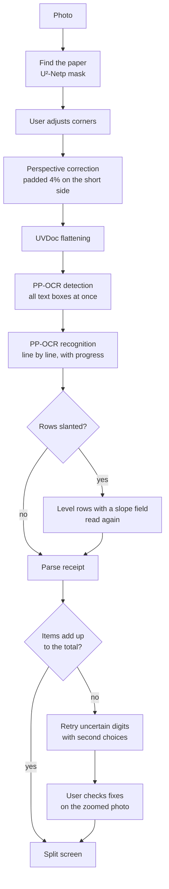

<p align="center"></p>

<h1 align="center">SlipSplit</h1>

<p align="center"><b>Snap a receipt, tap who had what, split it to the cent: fully offline on Android.</b></p>

<p align="center">
  <a href="https://github.com/albzO/SlipSplit/releases/latest"></a>
  <a href="LICENSE"></a>
  
  
  
  
</p>

<p align="center">
  <b>English</b> · <a href="README.zh.md">中文</a><br>
  <a href="https://github.com/albzO/SlipSplit/releases/latest">Download APK</a> · <a href="CHANGELOG.md">Changelog</a> · <a href="#how-it-works">How it works</a>
</p>

SlipSplit is an Android app that splits a shop or restaurant receipt between people. You take a photo, the app reads every item on the phone itself, and you tap items to assign them to each person. Nothing is uploaded: detection, flattening, text recognition and parsing all run offline.

The first target is Australian receipts, including bilingual Chinese and English ones from Asian supermarkets.

<table>
  <tr>
    <td align="center" width="25%"><b>Snap</b><br><sub>Corners found for you, even with a hand on the paper</sub></td>
    <td align="center" width="25%"><b>Read</b><br><sub>Flattened, levelled and read on the phone</sub></td>
    <td align="center" width="25%"><b>Tap</b><br><sub>Give each item to whoever had it</sub></td>
    <td align="center" width="25%"><b>Split</b><br><sub>Exact to the cent, shared as text or an image</sub></td>
  </tr>
</table>

## Features

- Photo from the camera or gallery, with automatic corner detection and manual adjustment. The frame stays on the paper when a hand holds it, and covers curled corners.
- Paper flattening (UVDoc) and row levelling before reading.
- Live recognition progress: text boxes appear as they are found and turn solid as each line is read.
- Items grouped into name, details and price, whatever the receipt layout.
- Misread digits corrected against the printed total, and shown to the user to check.
- Split screen: tap an item to give it to the selected person; shared items are split evenly; unpicked items go to the last person.
- Item discounts taken off once, whether the receipt prints the amount before or after them.
- Whole-bill discounts, surcharges, tips and rounding as a fixed amount split evenly, or by percentage when the receipt prints one. Tap the total to correct it or the adjustment.
- Summary that can be copied as text or shared as an image.
- History of finished splits: swipe up on the start screen to see them, tap one to edit it again, long-press to delete. The arrow and hint appear once there is a first split.
- English and Chinese interface, following the system language unless set in Settings.

## Install

Download `SlipSplit-<version>-arm64-v8a.apk` from [Releases](https://github.com/albzO/SlipSplit/releases/latest) and open it on the phone. It needs Android 7.0 or later and is about 73 MB; the x86_64 APK is for emulators.

> [!NOTE]
> Release APKs are signed with a debug key for now, so Android may warn before installing.

## Build and run

Open `SlipSplit/` in Android Studio and press Run.

From the command line, point `JAVA_HOME` at JDK 21:

```powershell
cd SlipSplit
./gradlew.bat :app:assembleDebug :app:testDebugUnitTest
```

Debug APKs are split by architecture; install `app-arm64-v8a-debug.apk` on a phone.

## Technology

| Layer | Choice |
| --- | --- |
| Language | Kotlin |
| UI | Jetpack Compose, Material 3, Navigation Compose, one activity |
| State | One `AndroidViewModel`; OCR runs on a single worker thread so models load once |
| Inference | ONNX Runtime for Android, a minimal build with only the operators the models use (`SlipSplit/ort/`) |
| Image processing | Android `Bitmap` and `Canvas`, plus small Kotlin geometry for the paper outline |
| Models | U²-Netp (paper mask), UVDoc (flattening), PP-OCR detection and recognition in Tiny and Small sizes |

<a id="how-it-works"></a>

## Recognition architecture



### Steps

<details>
<summary>Each step in detail</summary>

1. **Paper.** U²-Netp marks the receipt as the main object and the app fits four corners to the mask. The mask often takes in the hand holding the paper, so the corners come from straight lines: candidate quads are the convex outline reduced to four points and quads built from the long straight lines in the outline, and the one whose sides run along the outline furthest, less where they cross no outline, is kept. Fingers crossing a side touch it only briefly and do not count, and outline along the photo's edge is not taken for a side. Each side is then refitted to the straight middle of its outline and the corners put where sides meet, so a curled or torn corner is covered; a side the hand hides keeps its place. If no quad fits, the whole photo is kept. The user can drag the corners.
2. **Straightening.** The corners are rectified with a perspective transform, padded slightly so the paper edge is not cut, then UVDoc removes curl. The output keeps the same size, so later boxes match it directly.
3. **Detection.** PP-OCR detection finds every text box on the flattened photo. The screen draws them all as soon as detection ends.
4. **Recognition.** Each box is cropped, deskewed and read. The recognizer reports every line as it finishes, so the progress bar counts real lines. For each digit it also keeps the likeliest other digit and its probability.
5. **Language.** *Auto* reads freely and switches to an English-only character set when CJK characters are under 15% of the letters. *Chinese first* keeps every character, which mixed Chinese and English receipts need.
6. **Levelling.** If the boxes show rows that bend or slope, a smooth slope field is fitted to them, the photo is levelled and read a second time. The second read is kept unless it loses a total the first one matched.

</details>

## Data processing

`ReceiptParser.kt` turns OCR lines into items and totals. The rules are structural and are never fitted to one receipt.

<details>
<summary>Parsing rules, step by step</summary>

1. **Rows.** Boxes are placed in row coordinates. Printed rows share a vanishing point in a photo, so one fit corrects tilt and perspective at once. Boxes on the same printed line are joined left to right.
2. **Amount column.** Amounts aligned at the right edge form the price column. An amount in the middle of a line, such as `Normal Price: $3.48` or a unit price, is description, not a price. A table header such as `Description  Qty  Amount` fixes which column holds the amount.
3. **Fields.** Labels classify the totals: subtotal, total, tax and GST included, service and surcharge, discount, rounding and payment. Item count lines end the item list.
4. **Item blocks.** The first priced row decides the layout for the whole receipt:
   - *Price first*: a name sits beside its amount, so every amount starts an item and the rows below it, up to the next amount, are its details.
   - *Price last*: the name is printed above, so every amount closes the rows above it.
   - A weight or count row such as `1.234 kg NET @ $3.99/kg` prices the name printed above it, in either layout.
5. **Item discounts.** A negative amount right under an item is that item's discount, taken off the amount above it unless only the printed amounts add up to the total, which shows they are already discounted. When neither adds up, the choice waits until misread rows are dropped. A printed saving equal to the item discounts only sums them and is not taken off again.
6. **Digit correction.** When the items miss the subtotal or total to the cent, the parser tries the recognizer's second-choice digits, fewest changes first and at most three. It keeps a fix only when the sum matches exactly and the fix is at least twice as likely as any other fix of the same size. The app then shows each fix on the photo for the user to check.
7. **Reconciliation.** If items still exceed the total, the fewest rows whose removal makes it add up are moved aside as misreads, such as a subtotal read as an item.
8. **Header.** The shop name is a legal name if one is printed, otherwise the tallest text in the header. The date and time come from the first plausible date.

</details>

### Splitting

`BillSplit.kt` works in cents:

- An item picked by several people is shared equally; the first picker takes any odd cent.
- An item nobody picked goes to the last person in the list.
- The whole-bill adjustment is what the printed fields leave on top of the items: nothing when the items already add up to the total, the gap to the total when a subtotal matches the items, otherwise the service charge less the discount, plus tax when it is added on top.
- The adjustment is a fixed amount split evenly among the people who took something. It is shared by what each person took only when the receipt prints a percentage on a discount or charge row, or adds tax on top. The user can edit the total, the adjustment and the percentage switch.
- Leftover cents go to the largest remainders, so the shares always add up to the items plus the adjustment.

## Code map

All app code is in `SlipSplit/app/src/main/java/local/ocrbridge/`.

<details>
<summary>File by file</summary>

| File | Purpose |
| --- | --- |
| `MainActivity.kt` | Activity, navigation and screen transitions |
| `AppViewModel.kt` | State for one receipt from photo to split; runs the pipeline |
| `AppSettings.kt` | Model, receipt language, interface language and record keeping |
| `PaperBoundary.kt`, `Outline.kt` | Paper corners from the U²-Netp mask, in plain Kotlin |
| `Perspective.kt`, `Dewarper.kt` | Perspective correction and UVDoc flattening |
| `PpOcr.kt` | PP-OCR detection and recognition on ONNX Runtime, with progress and second-choice digits |
| `TextLevel.kt` | Row slope field, levelling and the second read |
| `Language.kt` | Receipt language choice and English detection |
| `ReceiptParser.kt` | Items, totals, shop and date from OCR lines |
| `BillSplit.kt` | Split arithmetic in cents |
| `History.kt` | Finished splits, with their receipt photo and OCR lines, in the app's private storage |
| `RunLog.kt`, `RunExport.kt` | Recognition records on the phone and their zip export |
| `ui/` | Compose screens, the receipt canvas, the share image and localisation |

The launcher icon is an adaptive icon in `res/drawable/ic_launcher_foreground.xml`: one receipt torn into a blue and an orange half, on a dark background.

</details>

## Models

Models live in `SlipSplit/app/src/main/assets/`. The ORT-format files the app loads are in Git, so a fresh clone builds as is; the `.onnx` sources are ignored by Git:

| Folder | Files | Source |
| --- | --- | --- |
| `u2netp/` | `u2netp.onnx`, `u2netp.ort` | See `README.txt` in that folder |
| `ppocr/` | PP-OCR Tiny and Small, and UVDoc: `det`/`rec` as `.onnx` and `.ort` | Copy from an existing device or project copy |

The app loads only the `.ort` files; the `.onnx` files are their source and stay out of the APK. To replace a model, check the SHA256 listed in each folder's `README.txt` after downloading, then run `SlipSplit/ort/convert_models.ps1` to write the ORT-format copies the app loads; see `SlipSplit/ort/README.md`.

> [!WARNING]
> The bundled ONNX Runtime is not complete: it has kernels only for the operators these models use. A model with a different structure may need operators it lacks and then fails to load until the runtime is rebuilt, which takes about an hour; swapping weights in the same structure does not.

The retired DewarpNet model is kept outside the app in `models/dewarpnet/`.

## Tests

```powershell
cd SlipSplit
./gradlew.bat :app:testDebugUnitTest
```

- `ReceiptParserTest` replays OCR output from sample receipts against recorded results (`app/src/test/resources/receipts.json`, kept only on this machine because it holds private receipts), plus rules written as small cases.
- `BillSplitTest` covers shared items, the last person, fixed and percentage adjustments and exact totals.
- `PaperBoundaryTest` covers corners from synthetic masks, including a curled corner and a hand joined to the paper.
- `RunReplay` parses records pulled from a phone: set `REPLAY_RUNS` to their folder and it writes `replay.txt` there.
- `BoundaryReplay` finds corners for saved masks: set `BOUNDARY_RUNS` to a folder of runs, each with the U²-Netp output as `mask.f32` (320×320 little-endian floats) and the photo size in `size.txt`, and it writes `boundary.txt` there.

Records are only kept while *Keep recognition records* is on in Settings; it is off by default. Pull them from a phone:

```bash
adb pull /sdcard/Android/data/local.ocrbridge/files/runs logs/phone-runs
```

## Privacy and samples

> [!TIP]
> The app has no network permission: nothing on the receipt ever leaves the phone unless you share it.

- Recognition and parsing run on the phone, and the app has no network permission. Recognition records are off by default; when turned on they stay on the phone and leave it only through the export in Settings.
- Split history, including the receipt photo, stays in the app's private storage and is never exported.
- `samples/` holds private receipts and CC BY-NC samples. It is ignored by Git and must not ship with the app; sources and licences are in `samples/sources.json`.

## License

SlipSplit is licensed under the [Apache License 2.0](LICENSE). Third-party parts keep their own licences: ONNX Runtime is MIT, U²-Netp and PP-OCR are Apache-2.0, and UVDoc follows its project's licence. Model sources are listed in each assets folder's `README.txt`.

## History

The desktop Python bench and its score sheets were removed; restore them from commit `442abde` if needed. PP-OCR Small gave the best balance of accuracy and size. Medium was slightly more accurate but used much more memory and still misread faded digits, so the app dropped it; its files are kept outside the app in `models/ppocr-medium/`. ML Kit's Latin recognizer cannot read CJK receipts.
