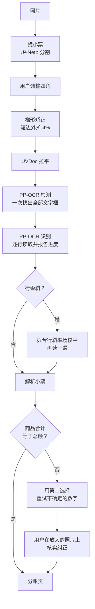

<h1 align="center">SlipSplit</h1>

<p align="center"><b>拍一张小票，点一下谁买了什么，精确到分地分账：安卓上完全离线。</b></p>

<p align="center">
  <a href="https://github.com/albzO/SlipSplit/releases/latest"></a>
  <a href="LICENSE"></a>
  
  
  
  
</p>

<p align="center">
  <a href="README.md">English</a> · <b>中文</b><br>
  <a href="https://github.com/albzO/SlipSplit/releases/latest">下载 APK</a> · <a href="CHANGELOG.zh.md">更新日志</a> · <a href="#how-it-works">工作原理</a>
</p>

SlipSplit 是一款按人分账的安卓 App。拍一张小票，App 在手机上读出每一项商品，你点一下就把商品记到某个人名下。照片不上传：找边、拉平、文字识别和解析全部离线完成。

首先面向澳洲小票，包括亚洲超市的中英双语小票。

<table>
  <tr>
    <td align="center" width="25%"><b>拍</b><br><sub>自动找四角，手握着也不跑偏</sub></td>
    <td align="center" width="25%"><b>读</b><br><sub>拉平、校平，在手机上识别</sub></td>
    <td align="center" width="25%"><b>点</b><br><sub>点一下就记到谁名下</sub></td>
    <td align="center" width="25%"><b>分</b><br><sub>精确到分，可复制文字或分享图片</sub></td>
  </tr>
</table>

## 功能

- 拍照或从相册选图，自动找小票四角，可手动微调。手握着小票时框不会跑到手上，卷起的角也会框进来。
- 识别前拉平纸张（UVDoc）并校平文字行。
- 实时显示识别进度：文字框一检测到就出现，每读完一行对应的框就变成实色。
- 不论小票怎么排版，都能把每项商品分成名称、明细和金额。
- 用小票总额纠正读错的数字，并让用户核实。
- 分账：点商品记到当前选中的人名下；多人选同一项就平分；没人选的商品归最后一个人。
- 单品折扣只扣一次，不论小票印的是折前还是折后金额。
- 整单折扣、附加费、小费和取整默认按固定金额平摊；小票上印了百分比时按比例分摊。点总额卡片可以修改总额和整单调整。
- 汇总可以复制成文字，或分享成图片。
- 分账历史：在首页上滑查看，点一条可以继续编辑，长按删除。保存第一条记录后，首页才会出现箭头和提示。
- 中英文界面，默认跟随系统语言，也可以在设置里切换。

## 安装

从 [Releases](https://github.com/albzO/SlipSplit/releases/latest) 下载 `SlipSplit-<版本>-arm64-v8a.apk`，在手机上打开安装。需要 Android 7.0 及以上，约 73MB；x86_64 版用于模拟器。

> [!NOTE]
> Release 包目前用调试密钥签名，安装时系统可能会提示风险。

## 构建和运行

用 Android Studio 打开 `SlipSplit/`，点 Run。

命令行需要先把 `JAVA_HOME` 指向 JDK 21：

```powershell
cd SlipSplit
./gradlew.bat :app:assembleDebug :app:testDebugUnitTest
```

Debug APK 按架构拆分，手机安装 `app-arm64-v8a-debug.apk`。

## 技术栈

| 层 | 选择 |
| --- | --- |
| 语言 | Kotlin |
| 界面 | Jetpack Compose、Material 3、Navigation Compose，单 Activity |
| 状态 | 一个 `AndroidViewModel`；OCR 在单个工作线程上运行，模型只加载一次 |
| 推理 | ONNX Runtime for Android，只含模型所用算子的精简构建（`SlipSplit/ort/`） |
| 图像处理 | Android `Bitmap` 和 `Canvas`，加上一小段 Kotlin 几何代码求小票轮廓 |
| 模型 | U²-Netp（小票分割）、UVDoc（拉平）、PP-OCR 检测和识别（Tiny / Small 两档） |

<a id="how-it-works"></a>

## 识别架构



### 步骤

<details>
<summary>展开每一步</summary>

1. **找小票。** U²-Netp 把小票当作画面主体分割出来，App 按分割结果求四个角。分割结果常把握着小票的手也包进来，所以四角按直线来定：候选四边形一部分来自把凸轮廓化简成四个点，一部分来自轮廓里的长直线两两组合；选四条边贴着轮廓走得最长、悬空最少的那个。手指只是横穿过边、贴着的距离很短，不算数；贴着照片边缘的轮廓也不当作纸边。之后每条边用中段的轮廓重新拟合成直线，取相邻两边的交点作为角点，卷角、缺角也能框进去；被手挡住的边保持原样。求不出四边形时保留整张照片。用户可以拖动四角。
2. **矫正。** 按四角做梯形矫正，四周略微外扩以免切掉纸边，再用 UVDoc 去掉纸张弯曲。输出尺寸不变，后续文字框可以直接对上。
3. **检测。** PP-OCR 检测在拉平后的照片上找出所有文字框，检测一结束界面就把它们全部画出来。
4. **识别。** 每个框被裁出、摆正后识别。识别器每读完一行就报告一次，所以进度条数的是真实行数。对每个数字，它还会记下可能性第二高的数字和概率。
5. **语言。** *自动* 先按全部字符读取，中日韩字符少于字母的 15% 时改用只含英文的字符集。*中文优先* 保留全部字符，中英混合的小票需要选这个。
6. **校平。** 如果文字框显示行是弯的或斜的，就按这些框拟合一个平滑的斜率场，把照片校平后再读一遍。默认采用第二遍的结果，除非它丢掉了第一遍已经对上的总额。

</details>

## 数据处理

`ReceiptParser.kt` 把 OCR 行变成商品和合计。规则全部基于结构，不针对任何一张小票。

<details>
<summary>展开解析规则</summary>

1. **行。** 文字框换算到行坐标。照片里同一张小票的打印行交于同一个消失点，所以一次拟合就能同时修正倾斜和透视。同一打印行上的框从左到右拼接。
2. **金额列。** 靠右对齐的金额组成价格列。行中间的金额，比如 `Normal Price: $3.48` 或单价，是说明，不是价格。如果有 `Description  Qty  Amount` 这样的表头，就按表头确定哪一列是金额。
3. **字段。** 按标签识别合计类字段：小计、总额、税和已含 GST、服务费和附加费、折扣、取整和付款。`Item Count` 这类件数行表示商品列表结束。
4. **商品块。** 第一个有金额的行决定整张小票的排版：
   - *价格前置*：商品名和金额在同一行，每个金额开始一项商品，它下面到下一个金额之前的行都是这项商品的明细。
   - *价格后置*：商品名印在上面，每个金额结束它上面的那些行。
   - 无论哪种排版，`1.234 kg NET @ $3.99/kg` 这类重量或数量行都给上面那个商品名定价。
5. **单品折扣。** 紧跟在商品下面的负金额是这项商品的折扣，先从上面的金额里扣掉；只有原金额相加对得上总额、扣掉后对不上时，才认定金额已是折后价。两种都对不上时，等剔除读错的行之后再判断。印出的总优惠等于各项折扣之和时只当汇总，不再扣一次。
6. **数字纠正。** 商品合计和小计或总额差了哪怕一分钱时，解析会尝试识别器给出的第二选择数字：先改最少的位数，最多三位。只有合计精确对上，并且这种改法的可能性至少是同样位数其他改法的两倍，才会采用。App 随后把每处纠正标在照片上让用户核实。
7. **对账。** 如果商品合计仍然超过总额，就找出最少的几行，去掉后合计正好对上，把它们当作误读移到一边，比如被读成商品的小计。
8. **表头。** 店名优先取印出来的公司全称，否则取表头里字最大的那段文字。日期和时间取第一个合理的日期。

</details>

### 分账计算

`BillSplit.kt` 全部以分为单位计算：

- 多人选同一项商品时平分，零头给第一个选的人。
- 没人选的商品归名单里最后一个人。
- 整单调整是印出的字段在商品之外多出或少掉的金额：商品合计已等于总额时为 0；小计等于商品合计时取总额与小计之差；否则取服务费减折扣，税额另加在外时再加上税。
- 整单调整默认是固定金额，由选了商品的人平摊；只有小票在折扣或附加费行印了百分比，或税额另加在外时，才按各人商品金额的比例分摊。总额、整单调整和按比例开关都可以手动修改。
- 剩下的零头分给小数部分最大的人，所以各人金额加起来始终等于商品合计加整单调整。

## 代码结构

App 代码全部在 `SlipSplit/app/src/main/java/local/ocrbridge/`。

<details>
<summary>展开文件列表</summary>

| 文件 | 作用 |
| --- | --- |
| `MainActivity.kt` | Activity、页面导航和切换动画 |
| `AppViewModel.kt` | 一张小票从拍照到分账的状态，以及识别流程 |
| `AppSettings.kt` | 模型、小票语言、界面语言和识别记录开关 |
| `PaperBoundary.kt`、`Outline.kt` | 用 U²-Netp 分割结果求小票四角，纯 Kotlin 实现 |
| `Perspective.kt`、`Dewarper.kt` | 梯形矫正和 UVDoc 拉平 |
| `PpOcr.kt` | ONNX Runtime 上的 PP-OCR 检测和识别，带进度和数字第二选择 |
| `TextLevel.kt` | 行斜率场、校平和第二遍识别 |
| `Language.kt` | 小票语言选择和英文判断 |
| `ReceiptParser.kt` | 从 OCR 行读出商品、合计、店名和日期 |
| `BillSplit.kt` | 以分为单位的分账计算 |
| `History.kt` | 已完成的分账，连同小票照片和 OCR 文字，存在 App 私有目录 |
| `RunLog.kt`、`RunExport.kt` | 手机上的识别记录及其 zip 导出 |
| `ui/` | Compose 界面、小票画布、分享图片和多语言 |

App 图标是 `res/drawable/ic_launcher_foreground.xml` 里的自适应图标：深色底上一张撕成蓝、橙两半的小票。

</details>

## 模型

模型放在 `SlipSplit/app/src/main/assets/`。App 加载的 ORT 格式文件已提交到 Git，克隆后可以直接构建；`.onnx` 源文件被 Git 忽略：

| 目录 | 文件 | 来源 |
| --- | --- | --- |
| `u2netp/` | `u2netp.onnx`、`u2netp.ort` | 见该目录 `README.txt` |
| `ppocr/` | PP-OCR Tiny、Small 和 UVDoc：`det`/`rec` 的 `.onnx` 和 `.ort` | 从现有设备或项目副本复制 |

App 只加载 `.ort`，`.onnx` 是它们的转换来源，不会打进 APK。要更换模型时，下载后核对各目录 `README.txt` 里的 SHA256，再运行 `SlipSplit/ort/convert_models.ps1` 生成 App 实际加载的 ORT 格式副本，详见 `SlipSplit/ort/README.md`。

> [!WARNING]
> 内置的 ONNX Runtime 不完整：只包含这几个模型用到的算子。换成结构不同的模型时，可能用到它没有的算子，模型会加载失败，需要重新编译运行时（约 1 小时）；结构不变、只换权重则不用。

停用的 DewarpNet 模型保存在 App 之外的 `models/dewarpnet/`。

## 测试

```powershell
cd SlipSplit
./gradlew.bat :app:testDebugUnitTest
```

- `ReceiptParserTest` 用样本小票的 OCR 结果回放，和记录的结果比对（`app/src/test/resources/receipts.json`，含私人小票，只存在本机），另外还有按规则写的小用例。
- `BillSplitTest` 覆盖平分、最后一个人兜底、固定金额和按比例的整单调整，以及总额精确相等。
- `PaperBoundaryTest` 用合成的分割结果测试求四角，包括卷角和手与纸连在一起的情况。
- `RunReplay` 解析从手机拉回的识别记录：把 `REPLAY_RUNS` 设为记录所在目录，它会在那里写出 `replay.txt`。
- `BoundaryReplay` 对保存的分割结果求四角：把 `BOUNDARY_RUNS` 设为一个目录，每条记录放 U²-Netp 输出的 `mask.f32`（320×320 小端浮点）和写着照片宽高的 `size.txt`，它会在那里写出 `boundary.txt`。

只有在设置里打开 *保存识别记录* 时才会保存记录，默认关闭。从手机拉回识别记录：

```bash
adb pull /sdcard/Android/data/local.ocrbridge/files/runs logs/phone-runs
```

## 隐私和样本

> [!TIP]
> App 没有联网权限：除非你主动分享，小票上的内容不会离开手机。

- 识别和解析都在手机上完成，App 也没有联网权限。识别记录默认关闭；打开后记录只留在手机上，且只能通过设置里的导出带出手机。
- 分账历史（包括小票照片）存在 App 私有目录里，不会被导出。
- `samples/` 含私人小票和 CC BY-NC 授权的样本，被 Git 忽略，不要随 App 分发；来源和授权见 `samples/sources.json`。

## 许可证

SlipSplit 以 [Apache License 2.0](LICENSE) 授权。第三方组件沿用各自的许可证：ONNX Runtime 为 MIT，U²-Netp 和 PP-OCR 为 Apache-2.0，UVDoc 以其项目的许可证为准。模型来源见各 assets 目录的 `README.txt`。

## 历史

桌面 Python 比较台和跑分表已移除，需要时可从提交 `442abde` 恢复。PP-OCR Small 在准确率和体积之间最均衡；Medium 准确率略高，但占用内存多得多，而且同样会读错印淡的数字，所以 App 已不再包含它，模型文件保存在 App 之外的 `models/ppocr-medium/`。ML Kit 的拉丁文识别器读不了中日韩小票。
